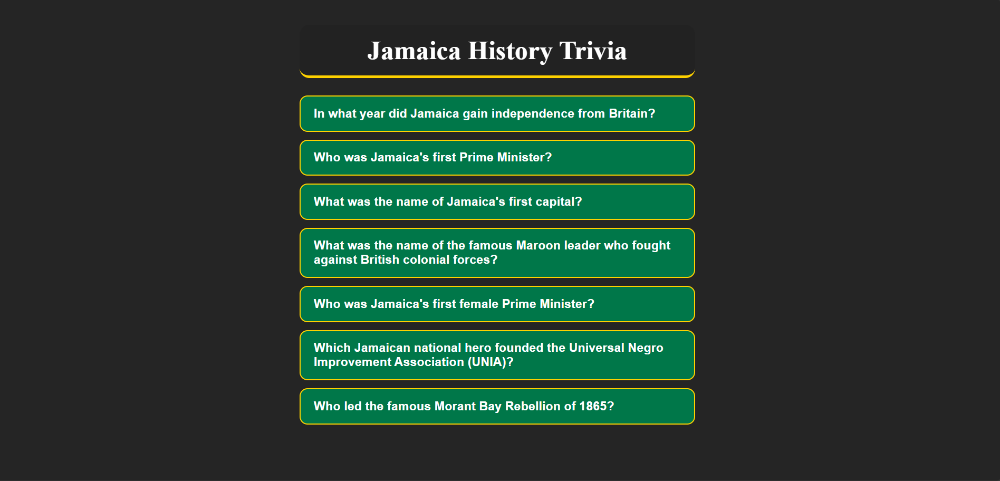

# **Welcome to Chicago**
## The United States of America is a quite huge country with many cities and states. One of the most beautiful cities in the USA is Chicago. Welcome to my journey.

---

# **Interactive Web Applications**

## **Jamaica Trivia Questions**

Designed and developed an interactive trivia application focused on Jamaican history, national milestones, and key historical figures. The application features a series of expandable questions that reveal answers when clicked, creating a simple and engaging user experience.

Try it: [Jamaica Trivia Questions](https://hayeomardev.github.io/Jamaicatrivia/)

**Technologies Used:** HTML5, CSS3, JavaScript, jQuery, Google Fonts

Using HTML, CSS, JavaScript, and jQuery, I implemented interactive accordion-style functionality with smooth slide animations and dynamic styling to provide visual feedback when users interact with questions.

The project also features custom CSS styling, a responsive-centered layout, a dark background paired with high-contrast green and gold question cards, hover effects, and Google Fonts typography to create a clean and approachable interface.

**Key Skills Demonstrated:**
* Front-End Web Development
* Semantic HTML Structure
* CSS Styling and Layout Design
* JavaScript DOM Manipulation
* jQuery Event Handling
* Interactive UI Development
* Accordion Functionality
* Animation and Transition Effects
* User Interaction and Visual Feedback
* Third-Party Library Integration

---

## **Multi Page**

Designed and developed a multi-page informational website featuring top-level navigation across Home, About, and Examples views. The showcased Examples page highlights "Chicago Through the Seasons," presenting climate overview copy alongside visual photography in a structured layout.

Try it: [Multi Page](https://hayeomardev.github.io/webdemo/examples.htm)

**Technologies Used:** HTML5, CSS3, Multi-Page Routing, Responsive Layout

Using semantic HTML5 and CSS3, I structured a multi-page web experience with a persistent navigation bar containing rounded buttons for Home, About, and Examples so visitors can move smoothly between pages.

The project also features a soft light-blue background, clear heading hierarchy, readable body copy explaining Chicago's humid continental climate (Dfa), and an embedded city skyline photograph integrated into the page flow.

**Key Skills Demonstrated:**
* Front-End Web Development
* Semantic HTML Structure
* CSS Styling and Layout Design
* Multi-Page Site Architecture
* Navigation Bar and Button Styling
* Typography and Content Hierarchy
* Media and Image Integration
* Responsive-Centered Layout
* User Interface Consistency

---

## **Weather Application**

Designed and developed an interactive weather forecast web application that allows users to select a city from a dropdown menu to view current conditions, temperature details, a color-coded temperature guide, and a multi-period forecast bar chart.

Try it: [Weather Application](https://hayeomardev.github.io/weatherapplication/)

**Technologies Used:** HTML5, CSS3, JavaScript, Chart Visualization, National Weather Service Data

Using HTML, CSS, and JavaScript, I built an interactive city selector dropdown that dynamically updates the displayed city name, temperature readout (such as 46°F for Dallas), and weather condition summary (such as Showers And Thunderstorms).

The project also features a color-coded Temperature Guide legend (Blue: 50°F or below, Green: 51°F to 75°F, Red: Above 75°F), a multi-interval Temperature Forecast bar chart spanning day and night periods, and attribution to the National Weather Service.

**Key Skills Demonstrated:**
* Front-End Web Development
* Semantic HTML Structure
* CSS Styling and Layout Design
* JavaScript DOM Manipulation
* Form Control and Dropdown Event Handling
* Dynamic Data Rendering
* Data Visualization and Charting
* Color-Coded Legend and UI Feedback
* External Weather Data Integration
